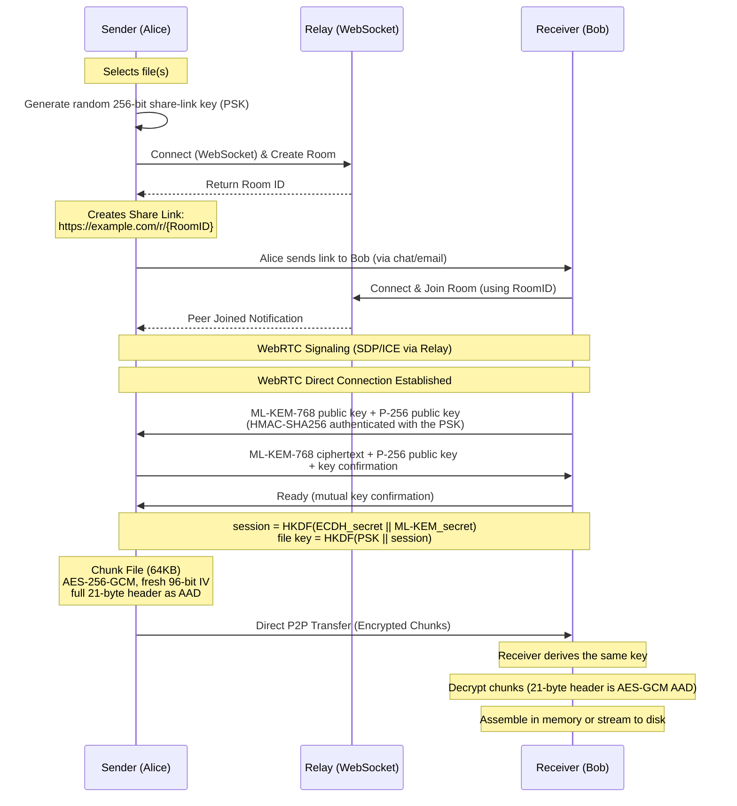

<!--
// Copyright (c) 2024-2026 Soumya Debnath. All Rights Reserved.
// Dual-licensed: AGPL-3.0-or-later (free, see LICENSE) OR a commercial licence
// (see COMMERCIAL_LICENSE.md) if you cannot meet the AGPL's source-disclosure terms.
// Contact: soumyadebnath1619@gmail.com
-->

<div align="center">
  <h1>PeerVault</h1>
  <p><b>PeerVault sends a file straight from one browser to another with end-to-end encryption, so it never lands on a server you have to pay for or trust.</b></p>

  [](https://www.gnu.org/licenses/agpl-3.0)
  []()
  []()
  []()
</div>

<br />

## What is PeerVault?

PeerVault is a browser SDK for serverless, end-to-end encrypted file transfers. It establishes a direct WebRTC DataChannel between sender and receiver browsers. Files are chunked and encrypted using the native Web Crypto API before they leave the sender's device. A lightweight Go relay server handles WebRTC signaling only — it never stores or sees file data.

---

## Table of Contents

1. [Installation](#installation)
2. [Security Architecture](#security-architecture)
3. [Cryptography — What the Code Actually Does](#cryptography--what-the-code-actually-does)
4. [API Reference](#api-reference)
5. [Usage Examples](#usage-examples)
6. [Deployment Guide (Go Relay)](#deployment-guide-go-relay)
7. [Known Limitations](#known-limitations)
8. [Comparison with Competitors](#comparison-with-competitors)
9. [FAQ](#faq)
10. [Author & License](#author--license)

---

## Installation

The SDK package lives in `sdk/`. This library is **not published to npm**.

### Option A — jsDelivr CDN (browser, no build step)

```html
<script type="module">
  import { PeerVaultSender, PeerVaultReceiver } from
    'https://cdn.jsdelivr.net/gh/itsoumya-d/peervault@main/sdk/dist/index.mjs';
</script>
```

### Option B — Clone and build

```bash
git clone https://github.com/itsoumya-d/peervault.git
cd peervault/sdk
npm install
npm run build
# sdk/dist/ is now available locally
```

---

## Security Architecture



### Key Design Points

- **Zero Server Storage:** Files travel directly peer-to-peer. The relay never buffers file data.
- **Hybrid post-quantum key agreement runs by default.** Each transfer performs ML-KEM-768 (FIPS 203) plus P-256 ECDH. The two secrets are concatenated and run through HKDF-SHA256, then bound to the share-link key. This addresses the "harvest now, decrypt later" threat for the transfer key.
- **Share link as a pre-shared authentication secret.** `createShareLink()` generates a random 256-bit key and embeds it in the URL fragment (`#key`). Browsers do not send fragments to servers. The key authenticates every handshake message with HMAC-SHA256, so a malicious signaling relay cannot substitute its own ephemeral keys. Anyone who obtains the full link can join the transfer, so treat the link as the secret.
- **AES-256-GCM chunk encryption.** Each 64 KB chunk uses a unique 12-byte IV. The transfer key is derived as `HKDF(PSK || hybrid_session, transcript)` and is never sent over the wire.
- **The full 21-byte frame header is authenticated.** The header is `[type:1][fileIndex:4][chunkIndex:4][IV:12]`. All 21 bytes — including the IV — are passed to AES-256-GCM as additional authenticated data. Tampering with any header byte causes decryption to fail. The receiver still range-checks `chunkIndex`, ignores duplicates, and verifies the assembled byte length against `metadata.size`.
- **Optional streaming to disk.** Pass a `sinkFactory` using `createFileSystemSink()` to write each decrypted chunk at its byte offset through the File System Access API. Peak memory stays at one chunk; without a sink, chunks are assembled into a `Blob` (about 1.5x the file size).

---

## Cryptography — What the Code Actually Does

PeerVault now performs genuine post-quantum key establishment. The earlier
retraction ("no lattice arithmetic exists in this repository") applied to the
pre-ML-KEM code and is no longer accurate.

### 1. ML-KEM-768 core (Rust → WebAssembly)

`pqc/` is a from-scratch FIPS 203 ML-KEM-768 implementation:

- Polynomial ring `R_q = Z_q[X]/(X^256 + 1)` with `q = 3329`.
- 7-layer Number Theoretic Transform (`ntt` / `invntt`) with Montgomery arithmetic.
- Centered Binomial Distribution sampling (`CBD_eta=2`) driven by SHAKE256.
- Uniform rejection sampling from SHAKE128, 12/10/4/1-bit FIPS 203 encoding,
  compression/decompression, and implicit rejection (`J(z || c)`).
- Key generation, deterministic encapsulation, and decapsulation.

It compiles to a 49 KB `wasm32-unknown-unknown` module with no imports and no
allocator. The module is embedded in the SDK as base64, so no extra asset fetch
is required.

**Validation**

- All 100 NIST KAT vectors in `pqc/tests/vectors/mlkem768_kat_sample.txt` pass
  for key generation, deterministic encapsulation, decapsulation, and implicit
  rejection (`cargo test --release`).
- `sdk/tests/hybrid.test.mjs` re-runs the first KAT vector against the bundled
  wasm, verifies tamper rejection, and cross-checks decapsulation against
  Node/OpenSSL's independent ML-KEM-768 implementation.
- `sdk/tests/e2e-hybrid.test.mjs` performs a 200 KB transfer end-to-end over
  in-memory WebRTC fakes using the default hybrid path.

### 2. Hybrid handshake

On DataChannel open the receiver sends a hello containing:

- an ephemeral ML-KEM-768 encapsulation key (1184 bytes),
- an ephemeral P-256 public key,
- a 16-byte nonce,
- an HMAC-SHA256 tag keyed by the share-link key.

The sender verifies the tag, encapsulates to both keys, and returns its P-256
public key, the ML-KEM ciphertext (1088 bytes), and a key confirmation. The
receiver decapsulates, derives the same session, verifies the confirmation, and
returns a MAC'd ready message. Both sides then derive:

```
transcript_hash = SHA-256(hello || sender_ecdh_pub || mlkem_ciphertext)
session_key     = HKDF-SHA256(ECDH_secret || ML-KEM_secret,
                              salt = transcript_hash,
                              info = "peervault/hybrid-session/v1")
file_key        = HKDF-SHA256(share_link_key || session_key,
                              salt = transcript_hash,
                              info = "peervault/file-key/v1")
```

The share-link key is a pre-shared secret: it authenticates the handshake and is
mixed into the file key. An attacker who records ciphertext but never obtains
the share link cannot derive the file key, even with a future quantum computer
that breaks P-256.

### 3. Chunk protection

Each 64 KB chunk is encrypted with AES-256-GCM under `file_key`, a fresh 96-bit
IV, and the entire 21-byte frame header as AAD. A flipped type byte, file index,
chunk index, or IV byte is rejected by the GCM tag before any plaintext is
written.

### 4. Capability reporting

- `PQCrypto.isMLKEMSupported()` reports whether the bundled wasm core can run
  (WebAssembly availability).
- `CryptoEngine.getCapabilities().usesPostQuantumKeyExchange` becomes `true`
  only after a hybrid handshake completes. It is not a static claim.
- `hybridHandshake: false` disables the handshake for interoperability with
  pre-PQC peers; transfers then fall back to the share-link key and are
  classical, not post-quantum.

### Validation and benchmarks

See [`docs/pqc-validation.md`](docs/pqc-validation.md) for KAT results, interop checks, protocol tests, and microbenchmarks. In short: 100/100 NIST KAT vectors, interop with Node/OpenSSL, 75/75 SDK tests, and a full handshake at p50 0.836 ms / p95 1.082 ms on an Apple Silicon laptop.

### Security scope

This implementation has not been independently audited. The wasm core is
constant-time by construction where practical, but JavaScript/wasm side channels
and the host browser's memory safety are outside its threat model. The share
link is the root of trust; if it leaks, an attacker can join the room. The
hybrid handshake protects recorded traffic against future quantum decryption,
but it does not provide identity verification beyond possession of the link.

---

### Federated vector/memory mesh

`MeshNode` synchronizes edgeinfer vector records and Reflexion memory entries
over any string transport (typically a WebRTC DataChannel). Entries carry a
logical version and an origin node id; merging is last-writer-wins with a
deterministic origin tie-breaker.

```ts
import { MeshNode, CryptoEngine } from 'peervault';

const node = new MeshNode('laptop-a');
node.upsertVector('chunk-1', embedding);       // Float32Array(768)
node.upsertMemory('lesson-1', 'check the tests', 1.0);

const channel = { send: (data: string | ArrayBuffer) => dc.send(data) };
node.startSync({ send: (data) => channel.send(data) });
dc.onmessage = (event) => {
  if (typeof event.data === 'string') node.handleMessage(event.data, {
    send: (data) => channel.send(data),
  });
};
```

For end-to-end control-message encryption, `CryptoEngine.encryptMessage()` and
`decryptMessage()` use AES-256-GCM with the 12-byte IV bound as AAD. Use the
key derived by the hybrid handshake so vector/memory sync inherits the same
ML-KEM-768 + P-256 session.

Local throughput (300 × 64 KiB chunks, Apple Silicon): encrypt **1395 MB/s**,
decrypt **1043 MB/s**. A 1,000 × 768-dim vector state serializes in 64.8 ms and
applies in 16.4 ms (4.16 MB base64 JSON). These are local crypto/serialization
measurements, not live P2P throughput. Reproduce with `npm run bench:throughput`.

## API Reference

The SDK package is at `sdk/`. All imports come from `sdk/dist/index.mjs`.

### `PeerVaultSender`

```typescript
const sender = new PeerVaultSender(signalingUrl: string, options?: SenderOptions);

interface SenderOptions {
  iceServers?: RTCIceServer[];   // add a TURN server here; default is STUN-only
  createRoomTimeoutMs?: number;  // default 30000; 0 disables
  stallTimeoutMs?: number;       // default 120000; 0 waits forever
}
```

- `addFiles(files: File[]): void` — queues HTML5 `File` objects for transfer. Throws `TypeError` if not given an array.
- `createShareLink(): Promise<string>` — connects to the relay, creates a room, generates a **random AES-256-GCM key**, and returns `roomId#keyBase64Url`. **Idempotent**: repeat calls resolve with the same link. Rejects if the relay does not acknowledge within `createRoomTimeoutMs`.
- `cancel(): void` — cancels transfer and closes all connections.

**Events (via `.on()`):**
- `recipient_connected` — receiver joined the room; transfer starts automatically.
- `progress` — yields a `TransferProgress` object.
- `complete` — all files sent.
- `error` — WebRTC or encryption error.

### `PeerVaultReceiver`

```typescript
const receiver = new PeerVaultReceiver(
  signalingUrl: string, shareLinkData: string, options?: ReceiverOptions
);

interface ReceiverOptions {
  iceServers?: RTCIceServer[];  // add a TURN server here; default is STUN-only
  connectTimeoutMs?: number;    // default 60000; 0 disables
  sinkFactory?: (metadata: FileMetadata, fileIndex: number) =>
    Promise<WritableFileSink | null>;  // optional streaming disk sink
}
```

`shareLinkData` is the exact string returned by `createShareLink()`.

- `connect(): Promise<FileMetadata[]>` — joins the room and waits for the sender's metadata payload. **Rejects** on relay errors (e.g. `Room not found or full`), on ICE failure, on signaling close, and after `connectTimeoutMs`.
- `download(): Promise<void>` — signals the SDK to begin processing incoming chunks.
- `cancel(): void` — permanently stops this receiver and closes connections. Buffered and queued chunks are discarded; an in-flight decryption cannot emit later progress, file completion, or transfer completion. Open disk sinks are closed. Subsequent `connect()` or `download()` calls reject; create a new receiver to retry. Blob URLs already delivered through `file_complete` remain owned by the caller.

**Events:** `progress`, `file_complete` (yields `ReceivedFile`), `complete`, `error`.

### `PQCrypto` (static class)

- `generateECDHKeyPair(): Promise<CryptoKeyPair>` — generates a P-256 ECDH key pair.
- `hybridKeyExchange(localPrivate, remotePublic, mlkemSharedSecret?, transcriptHash?): Promise<ArrayBuffer>` — ECDH derivation, or the HKDF-SHA256 combination of ECDH and ML-KEM secrets when both are supplied.
- `deriveSharedKey(sharedSecret, salt?, contextInfo?): Promise<CryptoKey>` — HKDF-SHA-256 → AES-256-GCM.
- `exportPublicKey(key): Promise<string>` — base64url-encodes the raw public key.
- `importPublicKey(base64url): Promise<CryptoKey>` — parses a base64url-encoded P-256 public key.
- `isMLKEMSupported(): boolean` — whether the bundled ML-KEM-768 wasm core can run in this environment. A completed handshake is reported separately by `getCapabilities().usesPostQuantumKeyExchange`.
- `probeMLKEM(): Promise<boolean>` — genuine runtime probe using ML-KEM's encapsulate/decapsulate key usages.
- `ecdhKeyExchange(localPrivate, remotePublic): Promise<ArrayBuffer>` — accurately named alias of `hybridKeyExchange`.
- `generateHybridKeyPair(): Promise<{ ecdh: CryptoKeyPair; mlkem?: CryptoKeyPair }>` — platform probe helper; PeerVault's default handshake uses the bundled wasm core instead.

### `MlKem768` and `HybridHandshake`

`MlKem768.load()` exposes `generateKeyPair()`, `encapsulate()`, and
`decapsulate()` backed by the bundled FIPS 203 wasm. `HybridHandshake` implements
the authenticated ML-KEM-768 + P-256 exchange described above; both are exported
for testability and for applications that want to build their own transport.

### Also exported

`CryptoEngine`, `MlKem768`, `HybridHandshake`, `FileChunker`, `FileAssembler`, `createFileSystemSink`, `CHUNK_SIZE`, `MAX_CHUNKS`, `PeerConnection`, `SignalingClient`, `DEFAULT_ICE_SERVERS`, `EventEmitter`. These are exported so that TURN servers can be supplied, streaming sinks can be attached, and the chunking/assembly path is directly testable in Node.

### Type Definitions

```typescript
interface FileMetadata {
  name: string; size: number; mime: string; chunks: number;
}
interface ReceivedFile extends FileMetadata {
  blob?: Blob;      // present for in-memory assembly
  url?: string;     // present for in-memory assembly
  streamed?: boolean; // true when written through a disk sink
}
interface TransferProgress {
  fileIndex: number; chunkIndex: number; totalChunks: number;
  bytesTransferred: number; totalBytes: number;
}
```

---

## Usage Examples

### Sending Files

```typescript
import { PeerVaultSender } from
  'https://cdn.jsdelivr.net/gh/itsoumya-d/peervault@main/sdk/dist/index.mjs';

const sender = new PeerVaultSender('wss://relay.yourdomain.com/ws');
sender.addFiles(Array.from(document.getElementById('file-upload').files));

const shareLinkData = await sender.createShareLink();
const fullUrl = `https://yourdomain.com/download#${shareLinkData}`;
console.log('Share this URL:', fullUrl);

sender.on('progress', (p) => {
  console.log(`${((p.bytesTransferred / p.totalBytes) * 100).toFixed(1)}%`);
});
sender.on('complete', () => console.log('Transfer complete'));
```

### Receiving Files

```typescript
import { PeerVaultReceiver } from
  'https://cdn.jsdelivr.net/gh/itsoumya-d/peervault@main/sdk/dist/index.mjs';

const hash = window.location.hash.substring(1);
const receiver = new PeerVaultReceiver('wss://relay.yourdomain.com/ws', hash);

const filesMetadata = await receiver.connect();
console.log('Incoming:', filesMetadata);

receiver.on('file_complete', (file) => {
  const a = document.createElement('a');
  a.href = file.url; a.download = file.name;
  document.body.appendChild(a); a.click();
  document.body.removeChild(a);
  URL.revokeObjectURL(file.url);
});

await receiver.download();
```

---

## Deployment Guide (Go Relay)

The relay is a stateless Go server. It routes SDP/ICE signaling only.

```bash
cd relay
go mod tidy
go run .
# Server starts on port 4002
```

### Environment Variables
- `PORT` (default: `4002`)

### Production (Docker)

```dockerfile
FROM golang:1.22-alpine AS builder
WORKDIR /app
COPY go.* ./
RUN go mod download
COPY . .
RUN go build -o peervault-relay

FROM alpine:latest
WORKDIR /app
COPY --from=builder /app/peervault-relay .
EXPOSE 4002
CMD ["./peervault-relay"]
```

WebRTC requires a secure context (`wss://`). Deploy the relay behind an SSL-terminating proxy.

---

## Known Limitations

- **Pre-release status.** Not on npm. No production adopters. API may change.
- **Not independently audited.** ML-KEM-768 is implemented and KAT-tested, but this SDK has not had a third-party security review. Do not treat it as audited production cryptography yet.
- **Hybrid handshake compatibility.** Both peers must support the PQC handshake. `hybridHandshake: false` keeps interoperability with pre-PQC peers but disables post-quantum protection.
- **No TURN relay by default — connections fail behind symmetric or carrier-grade NAT.** The default ICE configuration uses three public STUN servers (`stun.l.google.com:19302` x2, `stun.cloudflare.com:3478`) and no TURN server. Pass your own list to fix this:
  ```typescript
  new PeerVaultSender(url, { iceServers: [{ urls: 'turn:turn.example.com:3478', username: 'u', credential: 'p' }] });
  ```
  ICE failure now emits an `error` naming the ICE and connection states, and `connect()` rejects instead of hanging.
- **Transfers are not resumable.** If either tab closes the transfer must restart from the beginning. There is no chunk re-request protocol and no persisted state.
- **Streaming to disk is opt-in and Chromium-only.** Pass a `sinkFactory` using `createFileSystemSink()` (File System Access API) to write chunks directly to a user-selected file; otherwise the receiver assembles a `Blob` in RAM (measured peak ~1.5x file size). Sink writes use chunk offsets, so out-of-order delivery is supported. There is no resume across page reloads or persisted transfer state.
- **Protocol compatibility.** The default protocol authenticates the full 21-byte frame header and runs the hybrid handshake. Peers running a pre-AAD or pre-PQC build cannot interoperate with the defaults; upgrade both ends together, or explicitly disable `hybridHandshake` on both sides for the legacy key-only path.
- **1:1 sessions.** The relay supports one sender and one receiver per room.
- **Browser environment required** for full operation. `PeerVaultSender` and `PeerVaultReceiver` require `RTCPeerConnection` and `WebSocket`. `PQCrypto` static methods work in Node 24 (has `crypto.subtle`).

---

## Comparison with Competitors

| Feature | PeerVault | WeTransfer | Dropbox | Firefox Send |
| :--- | :--- | :--- | :--- | :--- |
| **E2E Encryption** | Yes (AES-256-GCM) | No | No | Yes |
| **P2P Transfer** | Yes (WebRTC) | No | No | Partial |
| **Server Storage** | Zero | Yes | Yes | Yes |
| **Bandwidth Cost** | Free | Paid Tiers | Paid Tiers | Paid |
| **Post-Quantum** | **Yes — ML-KEM-768 + P-256 (wasm)** | No | No | No |
| **Resumable transfers** | No | Yes | Yes | No |
| **Works behind symmetric NAT** | Only with your own TURN | Yes | Yes | Yes |

---

## FAQ

**Q: Can I transfer folders?**
PeerVault transfers flat arrays of files. Zip folder contents before passing to `addFiles()`.

**Q: What if the browser tab is closed?**
The transfer fails. Both peers must stay connected for the duration.

**Q: Is there a file size limit?**
Limited by receiver RAM, at roughly 1.5x the file size in peak memory. `MAX_CHUNKS` caps a declared transfer at 1,000,000 chunks (64 GB). Multi-GB transfers need a desktop with headroom; there is no streaming-to-disk path.

---

## 📄 License

**Dual-licensed — choose either:**

1. **[AGPL-3.0-or-later](LICENSE)** — free for any purpose, including commercial and production
   use. No payment, no permission, no key required. The obligation it carries: if you modify this
   software and let users interact with it over a network, you must offer those users your modified
   source under the same licence.

2. **[Commercial licence](COMMERCIAL_LICENSE.md)** — for organisations that cannot or prefer not to
   meet the AGPL's source-disclosure obligation. This buys an exception, not access.

Contributions are accepted under AGPL-3.0-or-later. Full terms: [LICENSING.md](LICENSING.md).

## ⚖️ Commercial licence (optional)

> **This software is free under [AGPL-3.0-or-later](LICENSE) — including for commercial and
> production use.** The prices below buy one specific thing: an exception to the AGPL's requirement
> that you publish your modifications if you run a modified version as a network service.

| Tier | Price | For |
|:-----|:------|:----|
| **Indie** | $199/year | Solo developer, <$100K revenue |
| **Startup** | $1,499/year | Up to 10-25 devs, <$5M revenue |
| **Enterprise** | $7,999/year | Unlimited seats, unlimited revenue |
| **OEM / White-Label** | $14,999/year | Embed in your product |
| **Full IP Buyout** | $500,000 | Complete ownership transfer |

**Free under AGPL-3.0-or-later:** any use, including production and commercial, provided you meet the AGPL's terms.

[soumyadebnath1619@gmail.com](mailto:soumyadebnath1619@gmail.com) · [github.com/itsoumya-d](https://github.com/itsoumya-d)

© 2024-2026 Soumya Debnath. All Rights Reserved.
